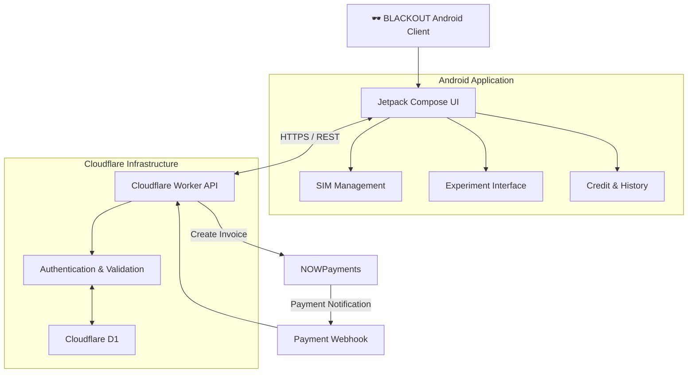

 <div align="center">

# 🕶️ BLACKOUT

### ANDROID TELEPHONY SECURITY RESEARCH FRAMEWORK

**CONTROL THE SIGNAL. UNDERSTAND THE SYSTEM.**

A research-oriented Android framework for controlled telephony security testing, powered by Kotlin, Jetpack Compose, and Cloudflare Workers.

<br/>

[](https://developer.android.com/)
[](https://kotlinlang.org/)
[](https://developer.android.com/jetpack/compose)
[](https://workers.cloudflare.com/)
[](https://www.typescriptlang.org/)
[](LICENSE)

<br/>

[Overview](#-overview) • [Architecture](#-architecture) • [Features](#-key-capabilities) • [Installation](#-installation) • [API](#-api-reference) • [Security](#-security)

<br/>

</div>

---

## ⚠️ Legal & Ethical Disclaimer

**BLACKOUT IS AN AUTHORIZED SECURITY RESEARCH TOOL.**

This project is developed exclusively for:

- Authorized security research.
- Controlled laboratory experiments.
- Defensive Android telephony evaluation.
- Testing on personally owned devices or explicitly authorized test environments.

The framework must never be used against devices, individuals, networks, or infrastructure without explicit authorization.

Unauthorized use may violate applicable laws and regulations.

**The developer assumes no responsibility for misuse, unauthorized deployment, or damages resulting from improper use of this software.**

> By using BLACKOUT, you acknowledge and accept responsibility for complying with all applicable laws and authorization requirements.

---

## 🔴 Overview

**BLACKOUT** is a research-oriented Android and Cloudflare Workers framework designed to investigate Android telephony behavior under controlled SMS and WAP Push testing conditions.

The project combines a native Android application with a serverless backend to provide a centralized environment for managing authorized experiments, application credits, payment transactions, and administrative operations.

Unlike a standalone testing utility, BLACKOUT integrates mobile-side functionality with cloud-based infrastructure.

### Project Highlights

| Component | Implementation |
|:---|:---|
| Android Client | Kotlin |
| User Interface | Jetpack Compose |
| Backend | Cloudflare Workers |
| Backend Language | TypeScript |
| Database | Cloudflare D1 |
| Payment Gateway | NOWPayments |
| Webhook Security | HMAC-SHA512 |
| Build System | Gradle |
| Backend Tooling | Wrangler |

---

## 🧩 Key Capabilities

### Android Client

- **Native Android Interface** — Built with Kotlin and Jetpack Compose.
- **SIM Management** — Select an available SIM for authorized laboratory testing.
- **Experiment Configuration** — Configure testing parameters through the client.
- **Credit Management** — Retrieve and consume application credits.
- **Execution History** — Review previous operations and local logs.
- **Backend Connectivity** — Communicate with the configured Cloudflare Worker API.
- **Administrative Access** — Access protected administrative functionality.

### Cloud Backend

- **Serverless Architecture** — Runs on Cloudflare Workers.
- **Persistent Storage** — Cloudflare D1 database integration.
- **Payment Processing** — NOWPayments invoice integration.
- **Webhook Validation** — HMAC-SHA512 signature verification.
- **Transaction Management** — Track payment states and credit transactions.
- **Administrative API** — Manage users, transactions, and credit plans.
- **Environment-Based Configuration** — Keep sensitive values outside source code.

---

## 🏗️ Architecture

BLACKOUT follows a modular client-server architecture.

The Android client communicates with the backend through HTTPS REST endpoints. The backend manages application data, transaction records, credit balances, and administrative operations.

### System Architecture



### Application Flow

1. The Android client initializes using its configured backend URL.
2. The application communicates with the Worker API.
3. The backend retrieves application data from D1.
4. Payment requests are processed through NOWPayments.
5. Payment notifications are verified before transaction processing.
6. Administrative requests are authenticated by the backend.

---

## 📁 Repository Structure

```text
blackout-framework/
│
├── android/
│   │
│   ├── app/
│   │   ├── src/
│   │   │   └── main/
│   │   │       └── java/
│   │   │           └── com/arashxzo/blackout/
│   │   │
│   │   ├── build.gradle
│   │   └── proguard-rules.pro
│   │
│   ├── gradle/
│   │   └── wrapper/
│   │
│   ├── build.gradle
│   ├── gradle.properties
│   ├── settings.gradle
│   └── local.properties.example
│
├── backend/
│   │
│   ├── src/
│   │   └── index.ts
│   │
│   ├── schema.sql
│   ├── package.json
│   ├── wrangler.jsonc
│   └── .dev.vars.example
│
├── .gitignore
├── LICENSE
├── README.md
├── project_dump.sh
└── project_dump.txt
```

---

## ⚙️ Installation

BLACKOUT consists of two independently configured components:

1. Cloudflare Worker Backend
2. Android Application

Configure and deploy the backend before connecting the Android client.

### Prerequisites

| Requirement | Version |
|:---|:---|
| Node.js | 18+ |
| npm | Included with Node.js |
| Android Studio | Latest stable |
| JDK | 17+ |
| Android SDK | API 35 |
| Minimum Android | API 29 |
| Cloudflare Account | Required |
| NOWPayments Account | Required for payment functionality |

---

### 01 — Clone Repository

```bash
git clone https://github.com/Arashxzo/blackout-framework.git

cd blackout-framework
```

### 02 — Configure Backend

Navigate to the backend directory:

```bash
cd backend
```

Install dependencies:

```bash
npm install
```

Create your local environment configuration:

```bash
cp .dev.vars.example .dev.vars
```

On Windows PowerShell:

```powershell
Copy-Item .dev.vars.example .dev.vars
```

Authenticate with Cloudflare:

```bash
npx wrangler login
```

### 03 — Create D1 Database

Create the database:

```bash
npx wrangler d1 create blackout-db
```

Cloudflare will return a database ID.

Copy that ID into:

```text
backend/.dev.vars
```

Configure the following values:

```env
D1_DATABASE_ID=YOUR_DATABASE_ID

NOWPAYMENTS_API_KEY=YOUR_API_KEY
NOWPAYMENTS_IPN_SECRET=YOUR_IPN_SECRET

ADMIN_SECRET=YOUR_STRONG_ADMIN_SECRET
```

**Important:** Never publish these values or commit `.dev.vars` to Git.

### 04 — Initialize Database

Generate Cloudflare Worker types:

```bash
npm run types
```

Initialize the remote database schema:

```bash
npm run db:init
```

For a local development database:

```bash
npm run db:init:local
```

### 05 — Configure Production Secrets

Before processing production payment notifications, configure your Cloudflare secrets:

```bash
npx wrangler secret put NOWPAYMENTS_API_KEY

npx wrangler secret put NOWPAYMENTS_IPN_SECRET

npx wrangler secret put ADMIN_SECRET
```

### 06 — Run Backend Tests

Execute the automated test suite:

```bash
npm test
```

Run the development server:

```bash
npm run dev
```

### 07 — Deploy Backend

Deploy the Worker:

```bash
npm run deploy
```

After successful deployment, your backend endpoint will resemble:

```text
https://blackout-backend.YOUR_SUBDOMAIN.workers.dev
```

Keep this URL for Android configuration.

---

## 📱 Android Configuration

### 01 — Configure Local Properties

Navigate to the Android directory:

```bash
cd android
```

Copy the configuration template:

```bash
cp local.properties.example local.properties
```

On Windows PowerShell:

```powershell
Copy-Item local.properties.example local.properties
```

### 02 — Configure Backend URL

Open:

```text
android/local.properties
```

Set your Cloudflare Worker URL:

```properties
BACKEND_URL=https://blackout-backend.YOUR_SUBDOMAIN.workers.dev
```

Configure the Android SDK path if it is not already configured.

**Note:** Do not include a trailing slash in `BACKEND_URL`.

### 03 — Build & Run

1. Open the `android/` directory in Android Studio.
2. Allow Gradle synchronization to complete.
3. Verify the backend configuration.
4. Connect an authorized Android test device.
5. Build and run the application.

### Release APK

To generate a signed APK:

```text
Build
  └── Generate Signed Bundle / APK
        └── APK
              └── Release
```

Keep your signing keystore and passwords private.

---

## 🔌 API Reference

The backend exposes REST endpoints for application functionality, payment processing, and administration.

### Public API

| Method | Endpoint | Description |
|:---:|:---|:---|
| `GET` | `/api/get-plans` | Retrieve active credit plans |
| `POST` | `/api/create-payment` | Create a payment invoice |
| `GET` | `/api/get-credits` | Retrieve device credit balance |
| `POST` | `/api/consume-credits` | Consume available credits |

### Payment Integration

| Method | Endpoint | Description |
|:---:|:---|:---|
| `POST` | `/api/nowpayments-webhook` | Process verified payment notifications |

### Administrative API

| Method | Endpoint | Description |
|:---:|:---|:---|
| `GET` | `/api/admin/stats` | Retrieve system statistics |
| `GET` | `/api/admin/users` | Retrieve registered devices |
| `GET` | `/api/admin/transactions` | Retrieve transaction history |
| `POST` | `/api/admin/user-action` | Manage user status and credits |
| `GET` | `/api/admin/plans` | Retrieve credit plans |
| `POST` | `/api/admin/plans/update` | Update plan configuration |

### Authentication

Administrative endpoints require a valid Bearer token:

```http
Authorization: Bearer YOUR_ADMIN_SECRET
```

Public application endpoints do not use this administrative authentication mechanism.

---

## 🛡️ Security Architecture

Security is an important part of BLACKOUT's backend design.

### Implemented Security Mechanisms

| Mechanism | Implementation |
|:---|:---|
| Secret Management | Local environment files and Wrangler secrets |
| Webhook Authentication | HMAC-SHA512 |
| Signature Validation | Recursive alphabetical key sorting |
| Payment Validation | Final transaction state verification |
| Duplicate Handling | Already-credited transaction protection |
| Admin Authentication | Bearer token |
| Database | Cloudflare D1 |

### Payment Verification

Payment notifications are validated before credit allocation.

The verification process includes:

1. Receive the payment notification.
2. Parse the incoming JSON payload.
3. Sort object keys recursively.
4. Calculate and verify the HMAC-SHA512 signature.
5. Validate the transaction record.
6. Check the payment status.
7. Credit the corresponding account only when the status is `finished`.

Previously credited transactions are not credited again.

### Security Best Practices

- Never hardcode credentials into application source code.
- Never expose `ADMIN_SECRET` inside the Android application.
- Keep `.dev.vars` and `local.properties` out of version control.
- Use HTTPS for all remote API communication.
- Protect Android signing keys.
- Restrict administrative access.
- Review deployment configuration before exposing the backend publicly.
- Perform testing exclusively in authorized laboratory environments.

---

## 🧪 Development & Testing

### Backend Development

```bash
cd backend

npm install

npm run dev
```

### Run Tests

```bash
npm test
```

### Watch Mode

```bash
npm run test:watch
```

### Generate Worker Types

```bash
npm run types
```

### Deploy

```bash
npm run deploy
```

---

## ⚠️ Project Limitations

BLACKOUT is an experimental proof of concept, not a production-ready telephony security platform.

Its behavior may vary depending on:

- Android version and device manufacturer.
- SIM configuration and carrier restrictions.
- Telephony service implementation.
- Network conditions.
- Backend configuration and service availability.

The backend and Android application should undergo independent security reviews before any production-oriented use.

---

## 📜 License

BLACKOUT is distributed under the **Apache License 2.0**.

You may use, modify, and distribute the software according to the terms of the license.

See the [LICENSE](LICENSE) file for complete details.

---

## 👨‍💻 Author

<div align="center">

**Arashxzo**

[](https://github.com/Arashxzo)

[](https://github.com/Arashxzo/blackout-framework)

<br/>

### 🕶️ BLACKOUT

**CONTROL THE SIGNAL. TEST THE SYSTEM.**

<sub>Built for authorized security research.</sub>

</div>