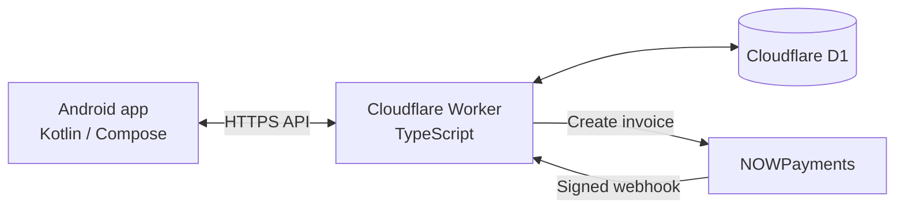

# BLACKOUT

**An Android telephony research app with a Cloudflare Workers backend.**

[](https://developer.android.com/)
[](https://kotlinlang.org/)
[](https://developer.android.com/jetpack/compose)
[](https://workers.cloudflare.com/)
[](https://www.typescriptlang.org/)
[](LICENSE)

BLACKOUT combines a native Android application with a serverless API for controlled telephony research. The Android client provides a SIM-aware interface for sending data SMS during authorized tests; the backend manages device credits, payment transactions, and administrative operations.

> **Use only in a controlled environment and on devices, SIMs, and networks you own or are explicitly authorized to test.** Sending messages can incur carrier charges and affect recipients or services. Do not use BLACKOUT to contact or disrupt third parties. You are responsible for complying with applicable laws, carrier rules, and the scope of your authorization.

## Contents

- [Features](#features)
- [Architecture](#architecture)
- [Repository layout](#repository-layout)
- [Requirements](#requirements)
- [Backend setup](#backend-setup)
- [Android setup](#android-setup)
- [API overview](#api-overview)
- [Testing and development](#testing-and-development)
- [Security and operational notes](#security-and-operational-notes)
- [License](#license)

## Features

### Android app

- Kotlin application with a Jetpack Compose interface.
- English and Persian UI options.
- SIM selection and device telephony permission handling.
- Data SMS test workflow with foreground-service progress and status logs.
- Credit balance checks, credit consumption, and payment plan display.
- Local operation history, including target, time, and requested quantity.
- Settings include device ID display/copy and clearing app preferences and cache.
- Administrative screens for account, transaction, and plan management.

### Backend

- Cloudflare Worker API with Cloudflare D1 persistence.
- Device credit balances, bans, usage counts, and transaction records.
- NOWPayments invoice creation and signed payment webhook processing.
- Admin-protected statistics, user actions, transaction listing, and plan management.
- Vitest tests using the Cloudflare Workers test environment.

The database schema seeds three active plans (`STARTER`, `PRO`, and `ELITE`). Their initial prices and credit amounts are defined in [`backend/schema.sql`](backend/schema.sql).

## Architecture



The Android app calls the Worker for plans, credit checks/consumption, and payment invoices. The Worker stores application state in D1 and processes payment notifications after signature verification. Configure the Android app with the deployed Worker URL; the URL is injected into the app at build time.

## Repository layout

```text
.
├── android/
│   ├── app/                 # Android app source, resources, and build config
│   ├── gradle/              # Gradle wrapper configuration
│   └── local.properties.example
├── backend/
│   ├── src/index.ts         # Cloudflare Worker routes
│   ├── test/                # Backend tests
│   ├── schema.sql           # D1 tables and initial plans
│   ├── package.json         # Backend scripts and dependencies
│   ├── .dev.vars.example    # Local secrets template
│   └── wrangler.local.jsonc.example
├── LICENSE
└── README.md
```

## Requirements

| Component | Requirement |
|---|---|
| Android build | Android Studio, JDK 21, Android SDK Platform 35 |
| Android device | Android 10 (API 29) or later; a compatible SIM is needed for telephony tests |
| Backend | Node.js 20 or later and npm |
| Cloud deployment | Cloudflare account with Workers and D1 access |
| Payment processing | NOWPayments account and API/IPN credentials |

The Android app targets API 35 and declares a minimum API level of 29. The Gradle daemon is configured to use JDK 21; Java source/target compatibility for the app is set to 17.

## Backend setup

Run the following commands from the repository root unless a step says otherwise.

### 1. Install dependencies and prepare local configuration

```powershell
cd backend
npm install
Copy-Item .dev.vars.example .dev.vars
Copy-Item wrangler.local.jsonc.example wrangler.local.jsonc
```

On macOS or Linux, use `cp` instead of `Copy-Item`.

### 2. Create and configure D1

Authenticate with Cloudflare and create the database:

```powershell
npx wrangler login
npx wrangler d1 create blackout-db
```

Copy the database ID returned by Wrangler into the `database_id` field in `wrangler.local.jsonc`. Also set `D1_DATABASE_ID` in `.dev.vars` to that same value. Keep the two values in sync.

### 3. Configure local environment values

Edit `backend/.dev.vars` and provide your own values:

```dotenv
D1_DATABASE_ID=YOUR_D1_DATABASE_ID
NOWPAYMENTS_API_KEY=YOUR_NOWPAYMENTS_API_KEY
NOWPAYMENTS_IPN_SECRET=YOUR_NOWPAYMENTS_IPN_SECRET
ADMIN_SECRET=REPLACE_WITH_A_LONG_RANDOM_SECRET
```

Do not commit `.dev.vars` or `wrangler.local.jsonc`; both are intended to remain local.

### 4. Initialize a local database and start the Worker

```powershell
npm run db:init:local
npm run dev
```

The development server uses `wrangler.local.jsonc`. Keep it running while testing the Android app against the local Worker. The Android emulator/device must be able to reach the configured backend URL.

### 5. Deploy the backend

Initialize the remote D1 database:

```powershell
npm run db:init
```

Set production secrets in Cloudflare. Wrangler prompts for each value:

```powershell
npx wrangler secret put NOWPAYMENTS_API_KEY --config wrangler.local.jsonc
npx wrangler secret put NOWPAYMENTS_IPN_SECRET --config wrangler.local.jsonc
npx wrangler secret put ADMIN_SECRET --config wrangler.local.jsonc
```

Then deploy:

```powershell
npm run deploy
```

Use the Worker URL printed by Wrangler in the Android configuration below. Local `.dev.vars` values are for local development; production secrets must be set in Cloudflare as shown.

## Android setup

### 1. Configure the Worker URL and Android SDK

Copy the template:

```powershell
cd ..\android
Copy-Item local.properties.example local.properties
```

Edit `android/local.properties`. Set `BACKEND_URL` to your Worker URL, without a trailing slash. Ensure `sdk.dir` points to your local Android SDK; the template includes path examples.

```properties
sdk.dir=C:\\path\\to\\Android\\Sdk
BACKEND_URL=https://blackout-backend.YOUR_SUBDOMAIN.workers.dev
```

`local.properties` is ignored by Git and should not be committed. If `BACKEND_URL` is unset or still has the template value, the app displays a configuration error instead of starting normally.

### 2. Build and run

1. Open the `android` directory in Android Studio.
2. Allow Gradle sync to finish and install the required SDK components if prompted.
3. Run the `app` configuration on an Android 10+ device or emulator.
4. For telephony testing, use a compatible test device/SIM and grant the requested permissions only when appropriate.
5. Confirm the configured backend is reachable before testing credit or payment flows.

To produce a release APK or app bundle, use Android Studio's **Build > Generate Signed Bundle / APK** flow and sign it with your own keystore. Keep the keystore and its credentials private.

## API overview

All routes are served by the Worker. JSON request fields for the write endpoints are shown in the table.

| Method | Path | Purpose |
|---|---|---|
| `GET` | `/api/get-plans` | List active credit plans |
| `POST` | `/api/create-payment` | Create an invoice; JSON: `deviceId`, `planId` |
| `GET` | `/api/get-credits?device_id={deviceId}` | Read a device's credits and banned status |
| `POST` | `/api/consume-credits` | Consume credits; JSON: `deviceId`, `amount` |
| `POST` | `/api/nowpayments-webhook` | Receive and verify NOWPayments notifications |
| `GET` | `/api/admin/stats` | Read user, usage, and revenue totals |
| `GET` | `/api/admin/users` | List registered devices |
| `GET` | `/api/admin/transactions` | List recent transactions |
| `POST` | `/api/admin/user-action` | Ban/unban/delete a device or set its credits |
| `GET` | `/api/admin/plans` | List all plans, including inactive plans |
| `POST` | `/api/admin/plans/update` | Update a plan |

Admin routes require the configured `ADMIN_SECRET` through the authorization mechanism used by the Worker. Keep this secret on the server; never embed it in the Android app or distribute it to clients. The webhook route validates the NOWPayments signature before processing a notification.

## Testing and development

From `backend/`:

```powershell
npm test
```

Run tests in watch mode:

```powershell
npm run test:watch
```

Start the local Worker:

```powershell
npm run dev
```

Generate Cloudflare Worker types:

```powershell
npm run types
```

The automated test suite covers backend routing and API behavior. The repository does not currently include an Android automated test suite.

## Security and operational notes

- The Android application requests SMS, phone-state, notification, and network permissions. Review the permission prompts and use only a dedicated, authorized test setup.
- The app sends binary/data SMS through the selected SIM. Carrier restrictions, device support, message charges, and delivery behavior vary.
- Configure conservative test quantities and destinations. Obtain explicit authorization before sending any message.
- Credits are consumed through the backend before the Android foreground service begins sending.
- Operation history is stored locally in app preferences. The settings wipe action clears app preferences and cache; it does not delete backend records or carrier records.
- Store `.dev.vars`, `local.properties`, production secrets, and signing keys securely. Never commit secrets or place the administrative secret in the client.
- The backend relies on Cloudflare and NOWPayments availability and correct account configuration. Review the deployment and payment settings before exposing a Worker to real users.
- BLACKOUT is a research project, not a production-certified telephony or payment platform. Review its behavior, legal requirements, and security posture before any deployment.

## License

BLACKOUT is distributed under the Apache License 2.0. See [`LICENSE`](LICENSE) for the full text.
