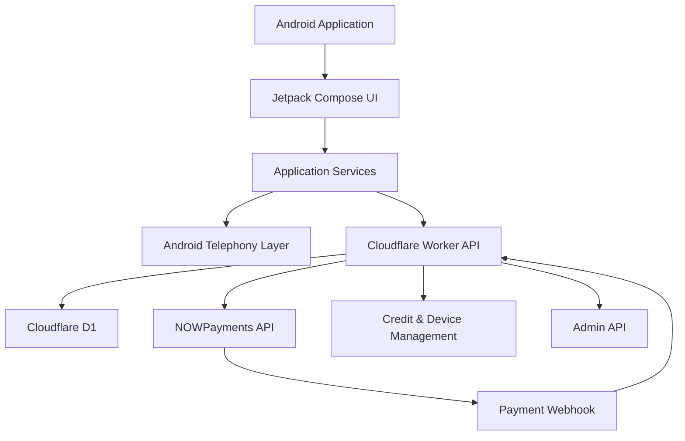

# BLACKOUT

### Android Telephony Research Framework

**A native Android client powered by Jetpack Compose, backed by a serverless Cloudflare Workers API.**

<p align="center">
  
  
  
  
  
  
  
</p>

---

BLACKOUT is an Android-based telephony research framework designed for controlled laboratory environments and authorized mobile network testing.

It combines a native Android application with a serverless backend infrastructure built on Cloudflare Workers. The Android client provides SIM-aware telephony functionality, while the backend handles device identification, credit management, payment processing, and administrative operations.

The project is designed around a modular architecture that separates mobile operations from backend services, allowing each component to be developed, tested, and maintained independently.

> [!CAUTION]
> **Authorized Research Only**
>
> BLACKOUT is intended exclusively for authorized security research, controlled laboratory experiments, and devices under your ownership or explicit permission.
>
> Unauthorized messaging, interference with third-party devices, or activity outside an approved testing scope may violate applicable laws and carrier policies.
>
> Telephony operations may incur carrier charges or affect recipients and services. You are responsible for obtaining authorization and complying with all applicable regulations.

---

## Table of Contents

- [Features](#features)
- [Architecture](#architecture)
- [Technology Stack](#technology-stack)
- [Requirements](#requirements)
- [Project Structure](#project-structure)
- [Backend Setup](#backend-setup)
- [Android Setup](#android-setup)
- [Testing](#testing)
- [API Reference](#api-reference)
- [Security](#security)
- [Deployment](#deployment)
- [Contributing](#contributing)
- [License](#license)

---

## Features

### Android Client

A native Android application built with Kotlin and Jetpack Compose.

- **Modern UI:** Native Jetpack Compose interface with English and Persian localization.
- **SIM Management:** SIM selection and telephony permission handling.
- **Telephony Operations:** Data SMS dispatch through an Android foreground service, subject to device, carrier, and platform compatibility.
- **Credit Management:** Real-time balance retrieval and server-side credit consumption.
- **Payment Integration:** Credit plan browsing and payment invoice creation.
- **Operation History:** Locally maintained operation records.
- **Application Settings:** Configurable application preferences.
- **Panic Wipe:** Local settings and cache clearing functionality.
- **Administration:** Integrated administrative interface.

### Cloudflare Backend

A serverless backend responsible for application state, payment processing, and administrative functionality.

- **Cloudflare Workers:** Serverless API execution.
- **Cloudflare D1:** Persistent storage for devices, licenses, transactions, and credit plans.
- **Payment Processing:** NOWPayments invoice generation.
- **Webhook Verification:** HMAC-SHA512 signature verification with recursively sorted JSON keys.
- **Credit Management:** Server-side balance validation and consumption.
- **Device Administration:** User management, credit adjustments, and device restrictions.
- **Plan Management:** Create, update, and manage credit plans.
- **Revenue Analytics:** Administrative statistics and transaction reporting.
- **Automated Testing:** Vitest-based backend test suite using the Cloudflare Workers test environment.

---

## Architecture

BLACKOUT follows a client-server architecture.



### Android Layer

The Android application is responsible for:

- User interaction and application navigation.
- SIM selection and permission management.
- Local operation history and settings.
- Communicating with backend endpoints.
- Executing authorized telephony operations.

### Backend Layer

The Cloudflare Worker handles:

- Device and credit management.
- Payment invoice generation.
- Payment notification verification.
- Transaction persistence.
- Administrative authorization.
- Application plan management.

### Data Flow

1. The Android application communicates with the backend over HTTPS.
2. The backend validates device information and available credits.
3. Payment requests are processed through NOWPayments.
4. Payment notifications are verified before transaction processing.
5. Application data and transactions are persisted in Cloudflare D1.
6. Credit consumption is handled server-side before the Android foreground service begins its operation.

The backend URL is injected into the Android application at build time through `local.properties`.

---

## Technology Stack

| Component | Technology |
|---|---|
| Mobile Platform | Android 10+ (API 29+) |
| Programming Language | Kotlin 2.2 |
| UI Framework | Jetpack Compose |
| Mobile Architecture | Native Android |
| Backend Runtime | Cloudflare Workers |
| Backend Language | TypeScript |
| Database | Cloudflare D1 |
| Backend CLI | Wrangler |
| Payment Provider | NOWPayments |
| Webhook Security | HMAC-SHA512 |
| Testing Framework | Vitest |
| Test Environment | Cloudflare Workers |

---

## Requirements

### Development Environment

| Requirement | Minimum |
|---|---|
| Android Studio | Compatible with the project's Gradle configuration |
| JDK | 17+ |
| Android SDK | Platform 35 |
| Node.js | 20+ |
| npm | Compatible with the project |
| Cloudflare Account | Workers and D1 access |
| NOWPayments | API credentials and IPN secret |

### Android Device

- Android 10 (API 29) or later.
- Compatible SIM card and carrier support.
- Required telephony permissions.
- Hardware and network support for the intended operation.

---

## Project Structure

```text
BLACKOUT/
│
├── android/
│   ├── app/
│   │   └── src/
│   ├── local.properties.example
│   └── ...
│
├── backend/
│   ├── src/
│   ├── test/
│   ├── .dev.vars.example
│   ├── wrangler.local.jsonc.example
│   ├── package.json
│   └── ...
│
├── .gitignore
├── LICENSE
└── README.md
```

*The directory listing above represents the main project layout. Individual source files may vary between versions.*

---

## Backend Setup

All backend commands should be executed from the `backend/` directory.

### 1. Install Dependencies

```powershell
npm install
```

### 2. Authenticate with Cloudflare

```powershell
npx wrangler login
```

Complete the authentication process in your browser.

### 3. Create the D1 Database

```powershell
npx wrangler d1 create blackout-db
```

Save the database ID returned by Wrangler.

### 4. Configure Local Environment

Create local configuration files from the provided templates:

```powershell
Copy-Item .dev.vars.example .dev.vars
Copy-Item wrangler.local.jsonc.example wrangler.local.jsonc
```

On macOS or Linux:

```bash
cp .dev.vars.example .dev.vars
cp wrangler.local.jsonc.example wrangler.local.jsonc
```

### 5. Configure Environment Variables

Update `wrangler.local.jsonc` with your D1 database ID.

Configure the required secrets in `.dev.vars` according to the template:

- `NOWPAYMENTS_API_KEY`
- `NOWPAYMENTS_IPN_SECRET`
- `ADMIN_SECRET`

Both configuration files are excluded from Git.

### 6. Generate Worker Types

```powershell
npm run types
```

### 7. Initialize the Database

```powershell
npm run db:init
```

### 8. Configure Production Secrets

Upload production credentials to Cloudflare:

```powershell
npx wrangler secret put NOWPAYMENTS_API_KEY --config wrangler.local.jsonc

npx wrangler secret put NOWPAYMENTS_IPN_SECRET --config wrangler.local.jsonc

npx wrangler secret put ADMIN_SECRET --config wrangler.local.jsonc
```

Use production credentials rather than local development values.

### 9. Deploy the Backend

```powershell
npm run deploy
```

After deployment, Wrangler will provide the Worker URL.

Keep this URL for the Android configuration.

---

## Android Setup

### 1. Navigate to the Android Directory

From the project root:

```powershell
cd android
```

### 2. Create Local Configuration

```powershell
Copy-Item local.properties.example local.properties
```

### 3. Configure `local.properties`

Open `android/local.properties` and configure:

```properties
sdk.dir=C\:\\Users\\YourUser\\AppData\\Local\\Android\\Sdk
BACKEND_URL=https://your-worker.workers.dev
```

Replace the SDK path and backend URL with your actual values.

**Important:**

- `sdk.dir` must point to your local Android SDK.
- `BACKEND_URL` must contain your deployed Cloudflare Worker URL.
- Do not include a trailing slash in `BACKEND_URL`.
- Do not commit `local.properties` to version control.

If `BACKEND_URL` is missing or still contains the placeholder, the application displays a configuration error rather than starting normally.

### 4. Build and Run

1. Open the `android/` directory in Android Studio.
2. Allow Gradle synchronization to complete.
3. Connect a compatible Android device.
4. Select the `app` run configuration.
5. Build and launch the application.

### 5. Generate a Release APK

To generate a signed release APK:

1. Open Android Studio.
2. Navigate to **Build → Generate Signed Bundle / APK**.
3. Select APK.
4. Create or select your own signing keystore.
5. Configure the release build.
6. Complete the signing process.

Keep your keystore and signing credentials private and securely backed up.

---

## Testing

BLACKOUT includes an automated backend test suite powered by Vitest and the Cloudflare Workers test environment.

### Run All Tests

From the `backend/` directory:

```powershell
npm test
```

The test environment requires `wrangler.local.jsonc` to exist.

If this is your first setup, create it from the example template before running tests.

### Watch Mode

```powershell
npm run test:watch
```

The test suite covers backend functionality, including API routing and application behavior.

---

## API Reference

All API endpoints are served through the Cloudflare Worker.

### Public Endpoints

| Method | Endpoint | Description |
|---|---|---|
| GET | `/api/get-plans` | Retrieve active credit plans |
| POST | `/api/create-payment` | Create a NOWPayments invoice |
| GET | `/api/get-credits?device_id=X` | Retrieve device credits and ban status |
| POST | `/api/consume-credits` | Consume available credits |
| POST | `/api/nowpayments-webhook` | Receive and verify payment notifications |

### Administrative Endpoints

| Method | Endpoint | Description |
|---|---|---|
| GET | `/api/admin/stats` | Retrieve usage, user, and revenue statistics |
| GET | `/api/admin/users` | List registered devices |
| GET | `/api/admin/transactions` | Retrieve recent transactions |
| POST | `/api/admin/user-action` | Ban, unban, delete, or modify device credits |
| GET | `/api/admin/plans` | Retrieve all credit plans, including inactive plans |
| POST | `/api/admin/plans/update` | Update an existing credit plan |

### Administrative Authentication

Administrative routes require a valid `ADMIN_SECRET`.

Include the secret in the HTTP Authorization header:

```http
Authorization: Bearer YOUR_ADMIN_SECRET
```

Never expose the administrative secret in the Android application, client-side code, public repositories, or logs.

### Payment Webhook Verification

The NOWPayments webhook endpoint validates incoming notifications using HMAC-SHA512.

The verification process uses recursively sorted JSON keys to ensure consistent signature generation.

Payment notifications must pass signature verification before they are processed.

---

## Security

Security and responsible operation are essential parts of BLACKOUT.

### Credential Protection

Never commit the following files:

- `.dev.vars`
- `wrangler.local.jsonc`
- `local.properties`
- Android signing keystores
- Private keys and API credentials

All sensitive configuration should remain outside version control.

### Production Secrets

Store production credentials using Cloudflare's secret management system:

```powershell
npx wrangler secret put ADMIN_SECRET
```

Rotate exposed credentials immediately.

### API Protection

Recommended production security measures:

- Apply Cloudflare WAF rules and rate limiting.
- Restrict access to administrative endpoints.
- Validate and sanitize incoming API requests.
- Verify payment webhook signatures.
- Monitor suspicious API activity.
- Protect administrative credentials.
- Review device identification and credit validation mechanisms.

### Data and Operation Handling

- Credit consumption is managed by the backend.
- Operation history is stored locally in application preferences.
- The settings wipe action clears local preferences and cache.
- Local wiping does not remove backend records, payment transactions, carrier records, or external logs.

### Deployment Responsibility

BLACKOUT is a research framework, not a guarantee of security, anonymity, or carrier compatibility.

Review the source code, deployment configuration, payment integration, and applicable legal requirements before deploying the project.

---

## Contributing

Contributions, bug reports, and technical improvements are welcome.

Before submitting changes:

1. Review the existing architecture.
2. Keep sensitive credentials out of commits.
3. Follow the established coding conventions.
4. Run the backend test suite.
5. Provide clear descriptions of behavioral changes.

For substantial changes, consider opening an issue before submitting a pull request.

---

## License

BLACKOUT is distributed under the **Apache License 2.0**.

You are free to use, modify, and distribute the software in accordance with the license terms.

See the [LICENSE](LICENSE) file for the complete license text.

---

<p align="center">
  <strong>BLACKOUT</strong>
  <br>
  <sub>Built for controlled telephony research and engineering.</sub>
</p>