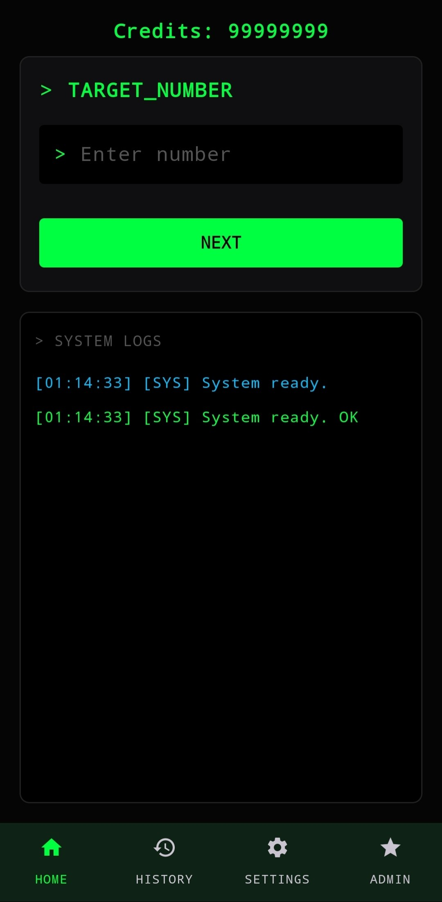
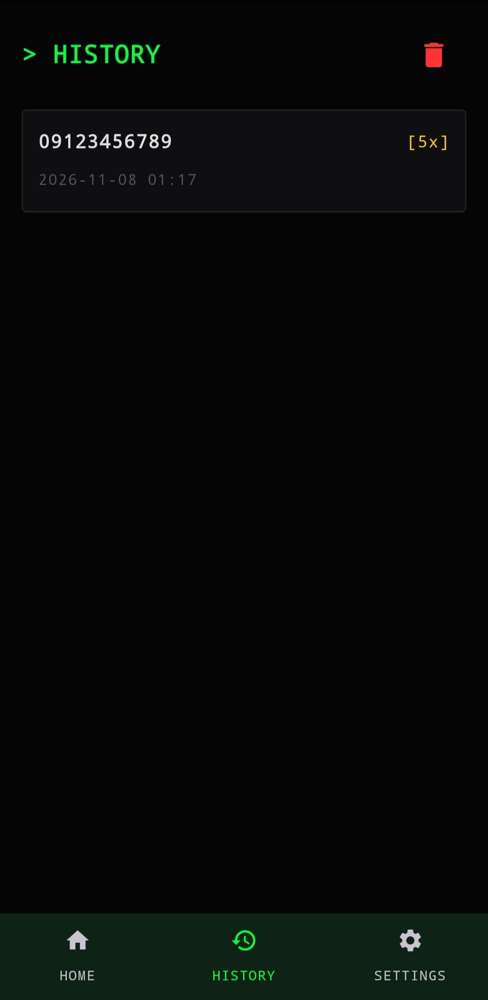
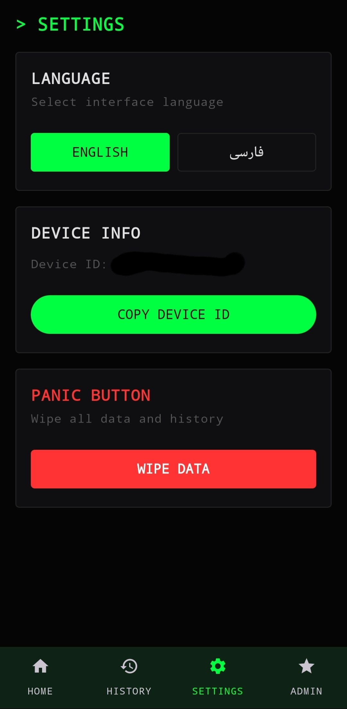
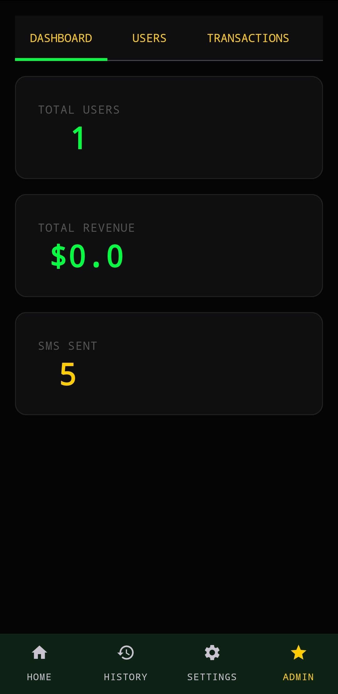

# BLACKOUT

**An Android framework for controlled research and testing of SMS capabilities**

BLACKOUT is a native Android application built with Kotlin and Jetpack Compose. The project includes an Android app and an optional Cloudflare Workers backend. The backend supports subscription and credit management; the app runs without a backend by default.

> **Use responsibly:** SMS capabilities in this project must only be tested on devices and SIM cards that you own or for which you have explicit, documented authorization. Sending unsolicited or bulk messages to other people, phone numbers, or services may cause disruption, incur costs, and result in legal consequences. Users are responsible for complying with applicable laws and obtaining any required consent.

## Screenshots

| Home | History |
|---|---|
|  |  |

| Settings | Admin panel |
|---|---|
|  |  |

## Features

- Native Android interface built with Jetpack Compose
- English and Persian user interfaces
- SIM information and device-related settings
- Local app history and history browsing
- Data-clearing option in Settings
- Runs independently of the backend by default
- Optional backend for credit, plan, payment, and administration features

## Operating modes

| Feature | Offline (default) | Subscription |
|---|---|---|
| `SUBSCRIPTION_ENABLED` | `false` | `true` |
| Backend required | No | Yes |
| Network requests for subscription features | None | Cloudflare Worker |
| Credit and payment management | Disabled | Enabled |
| Admin panel | Disabled | Enabled |

Subscription mode must be configured consistently in the Android app and the backend. If you do not need the backend, keep the default offline mode. In this mode, the app makes no network requests for subscription, payment, or credit-management services.

## Technology

### Android app

- Kotlin and Jetpack Compose
- Android Gradle Plugin `9.3.3`
- Gradle Wrapper `9.5.0`
- Java 17
- `compileSdk` and `targetSdk`: 35
- Minimum Android version: API 29 (Android 10)

### Optional backend

- TypeScript on Cloudflare Workers
- Cloudflare D1 for storage
- NOWPayments for subscription-mode payment flows
- Vitest and the Cloudflare Workers test environment

## Repository structure

```text
.
├── android/
│   ├── app/                 # Android application
│   ├── gradle/              # Gradle Wrapper
│   └── local.properties.example
├── backend/
│   ├── src/                 # Cloudflare Worker
│   ├── test/                # Backend tests
│   ├── schema.sql           # D1 database schema
│   ├── .dev.vars.example
│   └── wrangler.local.jsonc.example
├── screenshots/
├── LICENSE
└── README.md
```

## Development requirements

**Android**

- Android Studio compatible with Gradle 9.5
- JDK 17 or newer
- Android SDK Platform 35
- A test device or emulator running API 29 or newer

**Backend** (only if developing subscription mode)

- Node.js 20 or newer and npm
- A Cloudflare account with Workers and D1 access
- NOWPayments credentials for the intended test or production environment

## Configuration

The `*.example` files are templates. Before development, copy the appropriate template for each component to its local configuration file, and enter values only in the local copy:

- Android: `android/local.properties.example`
- Worker settings and D1 database ID: `backend/wrangler.local.jsonc.example`
- Backend secrets: `backend/.dev.vars.example`

For subscription mode, `SUBSCRIPTION_ENABLED` must be configured consistently in the Android and Worker settings, and the backend URL in the Android configuration must point to the intended Worker. In the default offline mode, the app does not require a backend.

**Never commit secrets.** Local files such as `local.properties`, `.dev.vars`, and `wrangler.local.jsonc`, as well as signing keys and payment-service credentials, must not be committed or published. Do not use sample values as real credentials.

## Backend tests

Tests use the configured Vitest runner and Cloudflare test environment. In PowerShell:

```powershell
cd backend
npm ci
npm test
```

To keep the test runner active while developing:

```powershell
npm run test:watch
```

The existing tests cover API routes, subscription settings, and storage behavior. See `backend/test/` and `backend/src/` for implementation details.

## Permissions and privacy

Depending on the features you use, the app requests permissions including SMS sending, phone/SIM information, and internet access (for subscription mode). Review the purpose of each permission before granting it, and only proceed on a test device under your control.

In the default offline mode, subscription and backend features are disabled. Subscription mode communicates with external services; review your configuration and the applicable privacy policies and terms before using it. Clearing data in the app cannot be undone; confirm the action only when you intend to delete local history and data.

## Contributing

When contributing:

1. Keep changes focused on a specific issue.
2. Run relevant tests and include the results in your change description.
3. Do not submit local configuration files, keys, passwords, or real user data.
4. Preserve safeguards for authorized and controlled use.

## License

This project is licensed under the **Apache License 2.0**. See [LICENSE](LICENSE) for the full text.
